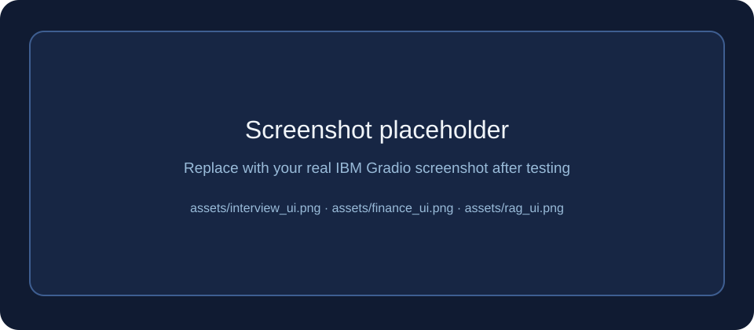

# Three small experiments with Gradio and watsonx

I built these projects to get better at debugging LLM apps. The question I kept coming back to was: if the output looks wrong, can I tell whether the problem came from my Python code, the context I sent, or the model's response?

| Project | Where I'd start |
|---|---|
| [AI Interview Arena](interview_arena/) | Try a technical question, answer it, and see how the model breaks down its feedback. |
| [Financial Scenario Simulator](finance_scenario_simulator/) | Change the cancellation rate and watch how it affects revenue and profit. The chart comes from Python; the optional explanation comes from the model. |
| [RAG Evidence Detective](rag_evidence_detective/) | Ask the same question twice with different wording and compare the retrieved passages. |

In the RAG notebook, “What caused the aerospace revenue decline?” retrieves the cancellation paragraph. Change that to “Why did aircraft clients drop their deals?” and the top results both score zero. That's a useful failure: the answer is in the document, but the keyword retriever doesn't recognize the paraphrase.

Run the offline checks from the repository root:

```bash
python tests/test_logic.py
```

The checks cover prompt building, finance arithmetic and invalid inputs, and passage ranking. To run the learning notebooks, install JupyterLab and Matplotlib and start Jupyter from the repo root.

For the apps, use the existing IBM Skills Network environment or install the original pins from [requirements-ibm.txt](requirements-ibm.txt) in a separate Python environment. Start one app at a time from the repo root:

```bash
python interview_arena/app.py
python finance_scenario_simulator/app.py
python rag_evidence_detective/app.py
```

All three use port 7860 and keep public sharing off by default. The inference client uses the Skills Network project, the IBM US South endpoint, and Mistral Small 3.1. Set `WATSONX_MODEL_ID` if the lab offers another model, such as Llama 4 Maverick. Use the lab's credential setup and preview instructions. Keep keys and private data out of the repo and demos.

The Python checks and notebook exercises ran offline. I still need to test the live IBM calls and Gradio screens in the lab. The images below and in each project README are placeholders until I can capture the real screens.


