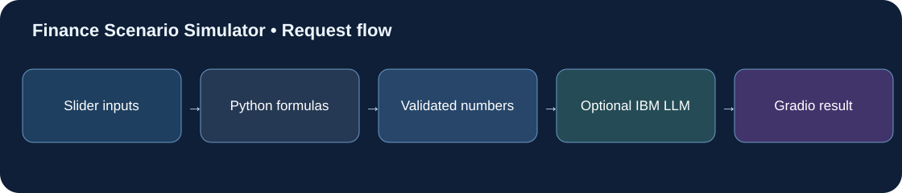

# Financial Scenario Simulator

**Status: learning prototype. Not yet validated against IBM-hosted inference.**



I wanted to see whether an LLM could explain a financial scenario without being responsible for the arithmetic. I put the calculations in Python and sent the resulting numbers to watsonx only when the explanation box is checked. That lets me validate the output before I look at what the model says.

## What is here
- `finance_scenario_simulator_learning_lab.ipynb`: the story and step-by-step experiment
- `logic.py`: functions I can understand and test separately
- `app.py`: Gradio Blocks interface using my existing IBM watsonx environment
- `../assets/screenshot_placeholder.svg`: replace with a real screenshot after I run it

## Running in IBM Skills Network
From the portfolio root (with the lab virtual environment activated):

```bash
python finance_scenario_simulator/app.py
```

The app starts on port 7860 with `share=False`. Use your lab’s preview or tunneling instructions if needed. **Never use private data or API keys in a publicly shared demo.** Stop any previous Gradio process before starting a different one.


## Current limits
This is not a deployed or production-grade application. We have not yet measured real model accuracy, cost, request concurrency, or security. The lab may have different dependency versions or account limits.

## Calculation and example

`simulate` first computes planned revenue = base × (1 + growth/100), then applies cancellations and costs as percentages. Operating profit is remaining revenue minus operating cost. For base 100, growth 10%, cancellations 20% and cost 70%, the outputs are planned revenue 110, remaining revenue 88, cost 61.6 and profit 26.4 million. A Gradio bar plot visualizes these figures. Values are illustrative, not a forecast or investment advice. At zero remaining revenue, the displayed margin is defined as 0 for this prototype; economically the ratio is undefined.
