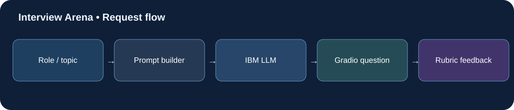
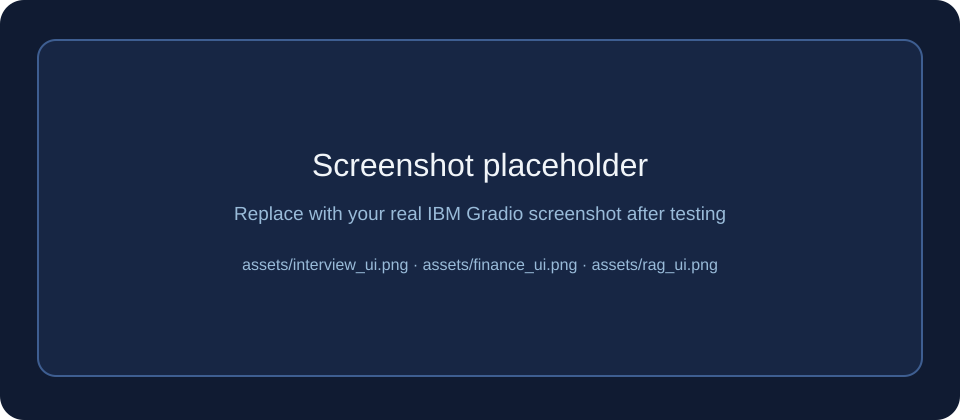

# AI Interview Arena

**Status: learning prototype. Not yet validated against IBM-hosted inference.**



I wanted an interview practice tool that could ask a follow-up instead of moving through a fixed question list. I started with an editable topic, a prompt I could inspect, and a four-part rubric. The follow-up is suggested as part of the feedback. The part I want to test next is whether the same answer gets similar feedback across runs.

## What is here
- `interview_arena_learning_lab.ipynb`: the story and step-by-step experiment
- `logic.py`: functions I can understand and test separately
- `app.py`: Gradio Blocks interface using my existing IBM watsonx environment
- `../assets/screenshot_placeholder.svg`: replace with a real screenshot after I run it

## Running in IBM Skills Network
From the portfolio root (with the lab virtual environment activated):

```bash
python interview_arena/app.py
```

The app starts on port 7860 with `share=False`. Use your lab’s preview or tunneling instructions if needed. **Never use private data or API keys in a publicly shared demo.** Stop any previous Gradio process before starting a different one.



## Current limits
This is not a deployed or production-grade application. We have not yet measured real model accuracy, cost, request concurrency, or security. The lab may have different dependency versions or account limits.

## Prompt and evaluation

`build_question_prompt` creates a single-question instruction from role, difficulty and topic. `build_feedback_prompt` requests feedback on correctness (40), causal explanation (30), trade-offs (20), and clarity (10). For example, role `AI Engineer`, difficulty `Intermediate`, and topic `RAG evaluation` produce a prompt asking for one question; the actual question depends on the model. These scores are model-generated and uncalibrated, not objective hiring decisions.
