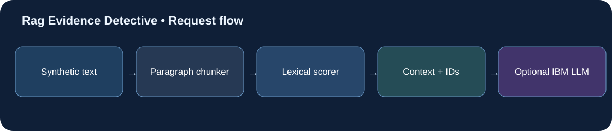
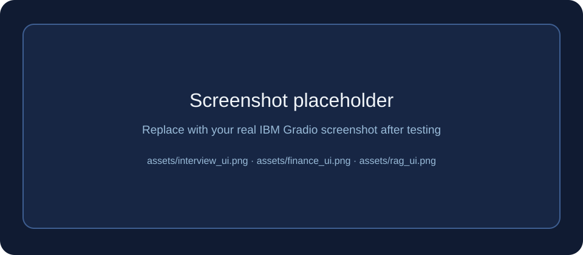

# RAG Evidence Detective

**Status: learning prototype. Not yet validated against IBM-hosted inference.**



I built this to see why a RAG answer can go wrong even when the document contains the answer. I started with keyword overlap so I could calculate a score by hand. The UI shows the passage IDs and prompt, which makes it easier to see whether the trouble started in retrieval or generation.

## What is here
- `rag_evidence_detective_learning_lab.ipynb`: the story and step-by-step experiment
- `logic.py`: functions I can understand and test separately
- `app.py`: Gradio Blocks interface using my existing IBM watsonx environment
- `../assets/screenshot_placeholder.svg`: replace with a real screenshot after I run it

## Running in IBM Skills Network
From the portfolio root (with the lab virtual environment activated):

```bash
python rag_evidence_detective/app.py
```

The app starts on port 7860 with `share=False`. Use your lab’s preview or tunneling instructions if needed. **Never use private data or API keys in a publicly shared demo.** Stop any previous Gradio process before starting a different one.



## Current limits
This is not a deployed or production-grade application. We have not yet measured real model accuracy, cost, request concurrency, or security. The lab may have different dependency versions or account limits.

## Retrieval experiment

`chunk_paragraphs` assigns each non-empty paragraph a source and ID. `retrieve` lowercases and tokenizes text into sets, then scores each passage as the count of unique query terms it shares with that passage. For “Which customers cancelled contracts?”, a passage containing “customers cancelled contracts” scores 3. Ties are ordered by ID. This is lexical overlap, not cosine similarity or semantic search. The prompt requests citations, but generated citations and their entailment are not verified. Try a paraphrase with no matching words to see where this baseline fails; zero-overlap passages can still be returned.
